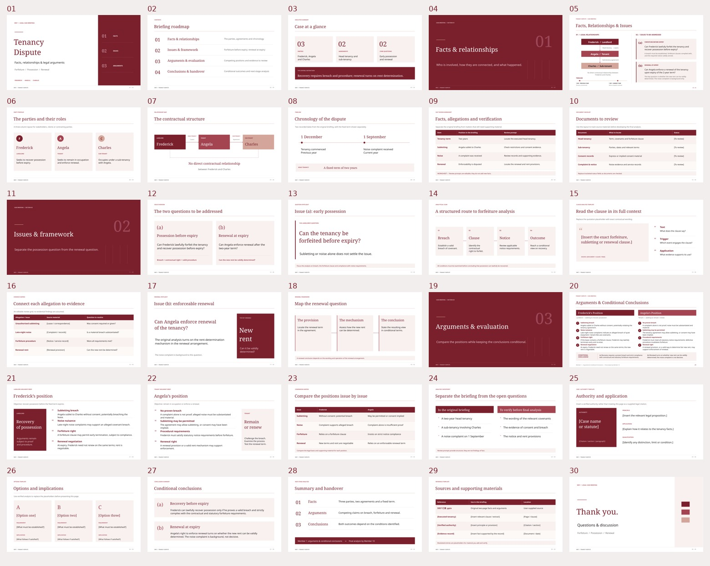

# 5957 汇报 · 30 页酒红高级模板

以最初上传的两页 `5957汇报.pptx` 为基础，扩展为 **30 页可编辑汇报模板**。沿用原稿的酒红、玫瑰红、浅粉配色及法律汇报风格，保留英文示例内容。

## 下载

- [一键下载完整包（ZIP）](https://github.com/naiwencui2-star/cuinaiwen/raw/refs/heads/main/downloads/5957-30pages/5957-burgundy-30pages-all.zip)
- [可直接编辑的 30 页 PPTX](https://github.com/naiwencui2-star/cuinaiwen/raw/refs/heads/main/downloads/5957-30pages/5957-burgundy-30pages.pptx)
- [可重复使用的 30 页 POTX 模板](https://github.com/naiwencui2-star/cuinaiwen/raw/refs/heads/main/downloads/5957-30pages/5957-burgundy-30pages-template.potx)
- [30 页 PDF 预览](5957-burgundy-30pages.pdf)
- [30 页版式总览](5957-burgundy-30pages-overview.jpg)

## 风格与使用

- 16:9 宽屏；酒红 `#7A202C`、玫瑰红 `#A34450`、浅粉 `#D4A59A`。
- 字体为 Noto Serif / Noto Sans，中文使用 Noto Sans CJK SC。字体未安装时，可在 PowerPoint 中替换为本机字体。
- 文字、线条、色块、图示和表格单元均为可编辑对象，整页未转成图片。
- 第 **5 页**与第 **20 页**保留最初两页的精修版结构；其他页面扩展为封面、目录、章节页、人物卡片、关系图、时间线、分析流程、证据矩阵、案例引用、结论与致谢等版式。
- 方括号内为待替换的占位内容；新增的条款、案例引用、证据和选项页为模板，不代表已经核实的材料。未添加虚构判例、法条或案件事实。
- 打开 PPTX 可直接编辑；打开 POTX 可创建同款演示文稿。按需要保留页面，替换文字或复制同类版式即可。

## 全部页面

| 页码 | 页面标题 | 版式类型 |
| --- | --- | --- |
| 01 | Tenancy Dispute | COVER |
| 02 | Briefing roadmap | CONTENTS |
| 03 | Case at a glance | EXECUTIVE SUMMARY |
| 04 | Facts & relationships | DIVIDER |
| 05 | Facts, Relationships & Issues | ORIGINAL STRUCTURE / REFINED |
| 06 | The parties and their roles | PARTY PROFILES |
| 07 | The contractual structure | RELATIONSHIP MAP |
| 08 | Chronology of the dispute | TIMELINE |
| 09 | Facts, allegations and verification | FACT REVIEW WORKSHEET |
| 10 | Documents to review | DOCUMENT CHECKLIST |
| 11 | Issues & framework | DIVIDER |
| 12 | The two questions to be addressed | ISSUE OVERVIEW |
| 13 | Issue (a): early possession | QUESTION SPOTLIGHT |
| 14 | A structured route to forfeiture analysis | ANALYTICAL FLOW |
| 15 | Read the clause in its full context | CLAUSE ANALYSIS TEMPLATE |
| 16 | Connect each allegation to evidence | EVIDENCE MATRIX |
| 17 | Issue (b): enforceable renewal | RENEWAL SPOTLIGHT |
| 18 | Map the renewal question | RENEWAL FRAMEWORK |
| 19 | Arguments & evaluation | DIVIDER |
| 20 | Arguments & Conditional Conclusions | ORIGINAL STRUCTURE / REFINED |
| 21 | Frederick’s position | LANDLORD ARGUMENT BRIEF |
| 22 | Angela’s position | TENANT ARGUMENT BRIEF |
| 23 | Compare the positions issue by issue | COMPARISON MATRIX |
| 24 | Separate the briefing from the open questions | ANALYSIS CHECKPOINT |
| 25 | Authority and application | CASE / AUTHORITY TEMPLATE |
| 26 | Options and implications | OPTIONS TEMPLATE |
| 27 | Conditional conclusions | CONCLUSION SUMMARY |
| 28 | Summary and handover | NEXT-STAGE ANALYSIS |
| 29 | Sources and supporting materials | REFERENCE TEMPLATE |
| 30 | Thank you. | CLOSING |

## 版式总览

