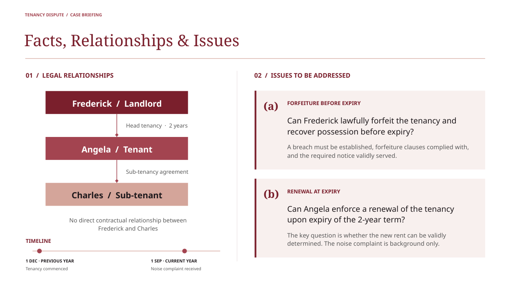
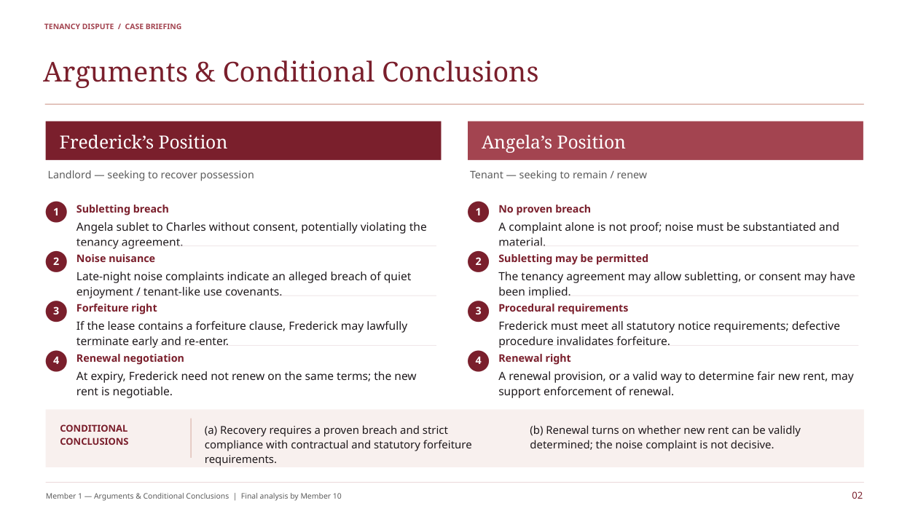

# 5957 汇报 · 同款酒红高级模板

保留原稿的酒红、玫瑰红与浅粉配色，以及两页法律汇报结构。文字、关系图、时间线和图形均可在 PowerPoint 中编辑。

## 下载

- [一键下载全部文件（ZIP）](https://github.com/naiwencui2-star/cuinaiwen/raw/refs/heads/main/downloads/5957/5957-burgundy-all.zip)
- [可编辑 PPT（PPTX）](https://github.com/naiwencui2-star/cuinaiwen/raw/refs/heads/main/downloads/5957/5957-burgundy.pptx)
- [同款模板（POTX）](https://github.com/naiwencui2-star/cuinaiwen/raw/refs/heads/main/downloads/5957/5957-burgundy-template.potx)
- [PDF 预览](5957-burgundy-preview.pdf)

PPTX 可以直接编辑；POTX 用于创建同款演示文稿。页面比例为 16:9。字体使用 Noto Serif 和 Noto Sans，未安装时可自行替换。

## 页面预览

## 30 页扩展版

[查看并下载 30 页同配色高级模板](../5957-30pages/README.md)
